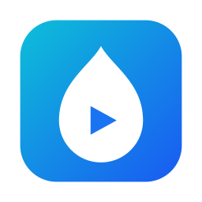
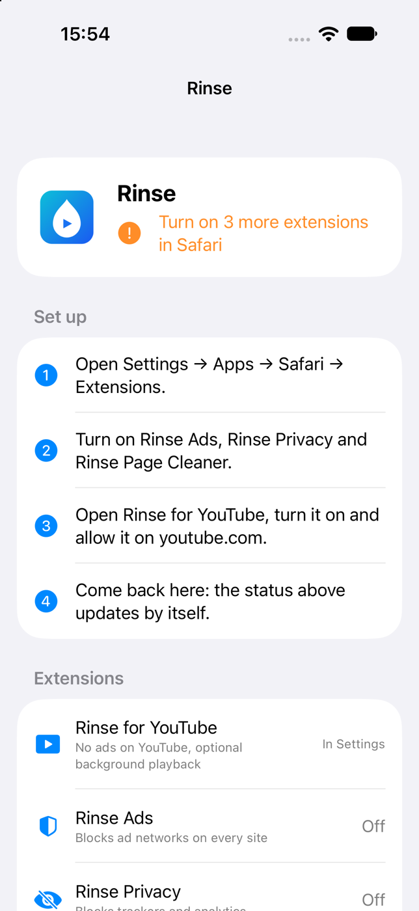
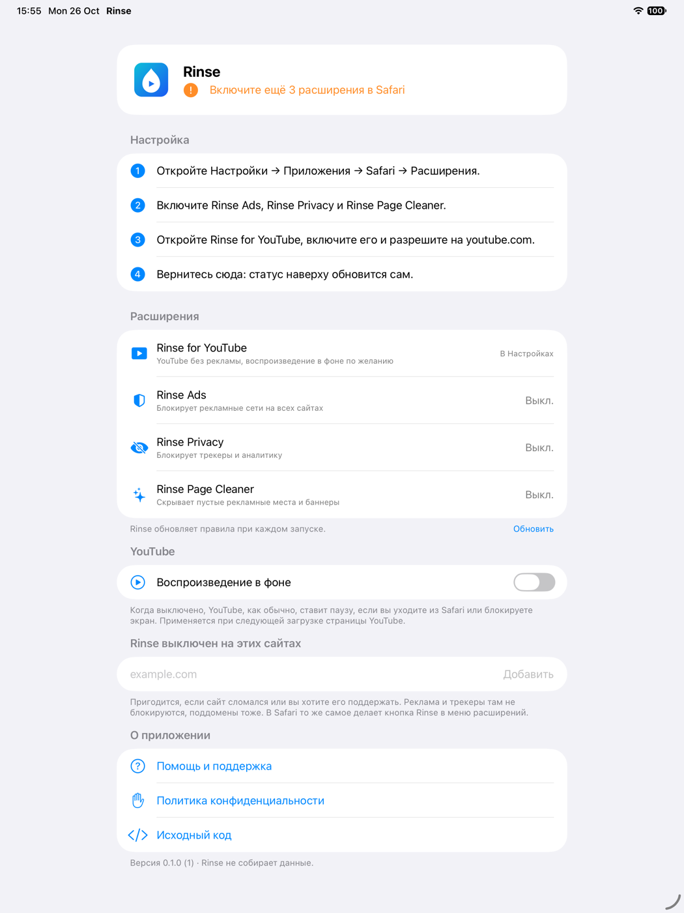
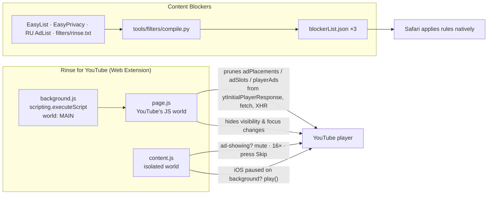

<p align="center">
  
</p>

<h1 align="center">Rinse</h1>

<p align="center">
  <b>Ad-free YouTube and a cleaner web, right inside Safari.</b><br>
  iPhone · iPad · Mac — no VPN, no proxy, no account.
</p>

<p align="center">
  
  
  
  
  
  
</p>

---

Rinse is a Safari extension app in the spirit of [Vinegar](https://andadinosaur.com/vinegar), with a site-wide ad blocker built in.

- **YouTube without ads.** Ads are cut out of the player data before they load. Anything that still slips through is muted, played at 16× and skipped automatically.
- **Background playback, if you want it.** Turn on *Keep playing in the background* in the Rinse app, and the video keeps playing when you lock the screen or switch apps. Pausing from the Lock Screen still works. It's off by default, so YouTube pauses as usual.
- **Ads and trackers blocked on every site.** Three Safari content blockers carry about 143,000 rules from EasyList, EasyPrivacy and RU AdList, plus Rinse's own rules.
- **Off with one tap where you need it.** If a site breaks, or you want to support it, turn Rinse off there from Safari's extensions menu or in the app. Subdomains are included.
- **Private by design.** The content blockers never see the pages you visit: Safari applies the rules itself. The YouTube extension only asks for access to `youtube.com`. Nothing is collected or sent anywhere.

<p align="center">
  
  &nbsp;
  
</p>

## What's inside

| Extension | What it does | Access |
|---|---|---|
| **Rinse for YouTube** | Strips ad payloads from the player, skips stitched ads, optional background playback | `youtube.com` only |
| **Rinse Ads** | Blocks ad networks (EasyList + RU AdList network rules, 75.7k) | none |
| **Rinse Privacy** | Blocks trackers and analytics (EasyPrivacy, 56.3k) | none |
| **Rinse Page Cleaner** | Hides leftover ad slots, banners and brandings (element hiding, 11k) | none |

The app shows at a glance whether everything is on, walks you through enabling the extensions step by step, and holds the settings: background playback and the sites where Rinse is off. It's in English and Russian.

## How it works



**YouTube.** A custom `<video>` player like the original Vinegar is no longer possible: as of 2026 YouTube serves no HLS, and direct stream URLs return 403 after about 12–16 MB without a PO token ([spike report](docs/spikes/youtube-streams.md)). So Rinse keeps YouTube's own player and takes the ads out of it:

1. `page.js` runs in YouTube's own JS world and deletes the ad fields from player responses before the player reads them. It's injected through `scripting.executeScript`, because YouTube's CSP blocks a plain `<script src>`.
2. If an ad still starts (for example, one stitched into the stream), `content.js` hides it with `rinse.css` and mutes it. A separate ad video jumps straight to its end; a stitched one plays at 16×. Then the ad's own Skip button gets pressed, found by its label inside the ad UI.
   After a removed or skipped ad, YouTube holds the video back server-side for about the ad's length. That can't be avoided from the page, so a small "Ad skipped · your video starts in a moment" note is shown instead of a frozen-looking player.
3. Background playback is off by default. The app stores the setting in an App Group, the extension's native handler reads it, and `content.js` caches it in `storage.local` and sets `<html data-rinse-background>` for `page.js`. When it's on, `content.js` swallows `visibilitychange`, `pagehide`, `blur` and `freeze` before YouTube sees them, `page.js` reports the page as visible, and if iOS still pauses the video while going to the background, it's resumed.

**Everything else.** `tools/filters/compile.py` converts Adblock Plus syntax into Safari's content-blocker JSON:

- network rules with options and `@@` exceptions;
- element hiding with per-domain `#@#` exceptions;
- `site.*` TLD wildcards, turned into page URL filters.

What Safari can't express (regex rules, `$redirect`, scriptlets, procedural selectors) is dropped and counted. The output is verified with WebKit's own compiler, and each CSS selector is checked by WebKit, because a single invalid one would silently disable the 250 selectors batched with it.

## Website

[nikolaikushner.github.io/rinse](https://nikolaikushner.github.io/rinse/) · [Privacy Policy](https://nikolaikushner.github.io/rinse/privacy.html) · [Support](https://nikolaikushner.github.io/rinse/support.html) (also in [Russian](https://nikolaikushner.github.io/rinse/ru/)). The pages live in `site/` and are published by `.github/workflows/pages.yml` on every push to `main` that changes them.

## Build and run

Requirements: Xcode 27+, [XcodeGen](https://github.com/yonaskolb/XcodeGen) (`brew install xcodegen`), and an Apple Developer team. The team ID is set in `project.yml`.

```sh
scripts/run.sh mac     # build and open the Mac app
scripts/run.sh ios     # build and install on a connected, unlocked iPhone or iPad
```

Or run `xcodegen generate && open Rinse.xcodeproj` and use the `Rinse_iOS` / `Rinse_macOS` schemes. `Rinse.xcodeproj` is generated and not committed.

### Turn the extensions on

- **Mac:** Safari → Settings → Extensions → turn on all four Rinse extensions. Allow *Rinse for YouTube* on youtube.com.
- **iPhone / iPad:** Settings → Apps → Safari → Extensions → turn on all four. Allow *Rinse for YouTube* on youtube.com.

Open the Rinse app once after installing or updating, so Safari reloads the rules.

### Check YouTube on Mac WebKit

`tools/youtube/try-youtube.swift` plays a real YouTube video in a `WKWebView` with Rinse's scripts and prints a per-second timeline: is an ad showing, is it hidden, does the video advance. `tools/youtube/check.sh` runs it several times on videos known to show ads. Run it before a release; with full Rinse you want `ad=0s`, and any stall should be covered by the note (`silentStall` ≤ 1s).

```sh
swift tools/youtube/try-youtube.swift oufxWa84Fxk             # full Rinse
swift tools/youtube/try-youtube.swift oufxWa84Fxk --no-rinse  # baseline
tools/youtube/check.sh 3
```

### Update the filter lists

```sh
scripts/update-filters.sh                                                   # download + compile
python3 -m unittest discover -s tools/filters                               # compiler tests
tools/tests/run-allowlist-tests.sh                                          # allowlist, incl. WebKit
swift tools/filters/validate.swift Extensions/Blockers/*/blockerList.json   # WebKit accepts the rules
```

If WebKit starts rejecting selectors, regenerate the reject list:

```sh
python3 tools/filters/compile.py --dump-selectors /tmp/s.txt
swift tools/filters/check-selectors.swift /tmp/s.txt > filters/invalid-selectors.txt
```

To see Rinse's state on a YouTube page, run `localStorage.setItem("rinse-debug", "1")` in the page console and reload. A status badge then shows whether `page.js` ran and how many ad fields were pruned, ads skipped and background resumes.

## Project layout

| Path | What |
|---|---|
| `App/` | SwiftUI container app: extension status, rule reload, how to enable |
| `Shared/` | Code shared by the app targets |
| `Extensions/YouTube/` | Safari Web Extension: `content.js`, `page.js`, `background.js` |
| `Extensions/Blockers/{Ads,Privacy,Cosmetic}/` | Content blockers; `blockerList.json` is generated, don't edit it by hand |
| `filters/` | `sources.json` (which lists go into which blocker), `rinse.txt` (our own rules), `invalid-selectors.txt` |
| `tools/filters/` | Filter compiler, its tests, and WebKit-based validators |
| `scripts/` | `run.sh`, `update-filters.sh`, icon generator |
| `site/` | Website for GitHub Pages: landing, privacy policy, support (EN + RU) |
| `Config/PrivacyInfo.xcprivacy` | Privacy manifest bundled in the app and every extension |
| `docs/appstore/` | App Store listing (EN + RU), review notes, raw and finished screenshots (`tools/appstore/make-screenshots.sh`) |
| `plans/`, `docs/spikes/` | Implementation plan and research notes |
| `spikes/` | Throwaway experiments and their tests, kept for reference |

## Status and limitations

Rinse is alpha: tested on an iPhone 14 Plus and a Mac, not yet on iPad.

- **Content blockers can only hide or block.** They can't rewrite styles, so a site that reserves space for an ad (such as the empty strip above HDrezka's header) keeps the gap.
- **No scriptlets.** Filters that need JavaScript on arbitrary sites are skipped, because running scripts everywhere would require "access to all websites".
- **Fragile by nature.** YouTube changes often. When it breaks, `page.js` and `content.js` fall back to YouTube's normal player rather than a black screen.
- **Updates ship with the app.** Filter lists update with app releases; there are no on-device updates yet.

See [plans/rinse.md](plans/rinse.md) for the roadmap: an element picker ("hide this"), a per-site allowlist, Shorts, embedded players and an App Store release.

## Price

Rinse will be on the App Store for **$1.99**, a one-time purchase that covers iPhone, iPad and Mac. That pays for the developer account and the time spent keeping up with YouTube. The source stays open: you're welcome to build it yourself for free.

## License

Copyright © 2026 Nikolai Kushner.

- **Code:** [GNU GPL v3.0](LICENSE). You may use, study, change and share it. Anything you distribute that's based on it must also be released under the GPL with its source.
- **Name and icon:** "Rinse" and the Rinse icon are not covered by the GPL. A fork must use its own name and icon.
- **Filter lists:** [EasyList and EasyPrivacy](https://easylist.to) (CC BY-SA 3.0) and [RU AdList](https://forums.lanik.us/viewforum.php?f=102) (CC BY 3.0). The compiled `blockerList.json` files stay under those licenses. See [LICENSES.md](LICENSES.md).

Inspired by Vinegar by And a Dinosaur. Rinse is not affiliated with YouTube or Google.

---

<details>
<summary><b>По-русски</b></summary>

**Rinse** — набор расширений Safari для iPhone, iPad и Mac.

- **YouTube без рекламы.** Рекламные данные вырезаются из ответов плеера. Если реклама всё-таки появляется, она идёт без звука на скорости ×16 и пропускается автоматически.
- **Фоновое воспроизведение по желанию.** По умолчанию выключено. Если включить в приложении Rinse переключатель *Keep playing in the background*, видео продолжит играть при заблокированном экране и при переключении на другое приложение.
- **Блокировка рекламы и трекеров на всех сайтах.** Около 143 тыс. правил из EasyList, EasyPrivacy и RU AdList, плюс собственные правила Rinse (например, против казино-брендинга на HDrezka).
- **Без сбора данных.** Блокеры не видят страниц, которые вы открываете: правила применяет сам Safari. YouTube-расширению нужен доступ только к `youtube.com`.

Сборка: `scripts/run.sh mac` или `scripts/run.sh ios`. Затем включите все четыре расширения в настройках Safari и один раз откройте приложение Rinse.

**Цена и лицензия.** В App Store Rinse будет стоить $1,99, одна покупка на iPhone, iPad и Mac. Код открыт под GPL-3.0: его можно собрать самому бесплатно, а форки обязаны оставаться открытыми. Название «Rinse» и иконка под GPL не входят.

</details>
